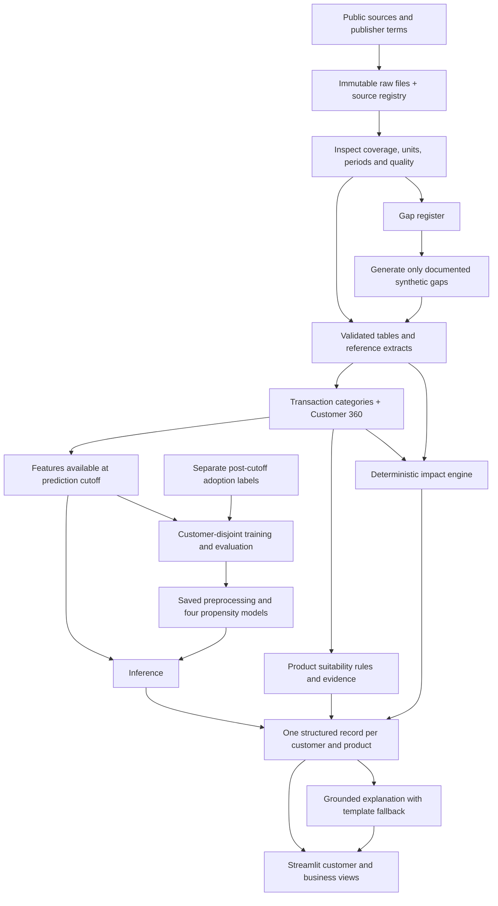

# Lloyds PS1: architecture, acquisition and existing solutions

Prepared 10 October 2026. Scope: EV Finance, Green Home Loan, Solar Finance and Paperless Banking. This document describes the proposed build; it does not claim that models or an application are already implemented.

## Approach and data policy

Use suitable, lawfully reusable public data first. Use synthetic data only for documented gaps in coverage, linkage or access within the hackathon time budget. This is our team preference; PS1 permits public, synthetic or mixed data without requiring public sources to be exhausted first.

Availability alone is insufficient: a source must match the required concept, geography, period and licence. Public retail customers cannot be joined to unrelated smart-meter households as real people. Such assembled profiles are explicitly synthetic. Real personal/confidential banking data must not be used.

## Architecture

### Responsibility of each component

| Component | Owns | Must not do |
|---|---|---|
| Acquisition/validation | Sources, licences, raw files, units, provenance, coverage gaps | Treat missing values as zero or unrelated datasets as linked customers |
| Categorisation | Exactly one of the eight required transaction categories | Assume retail giftware covers banking fuel/utility activity |
| Propensity ML | Probability of adoption within a declared window | Claim credit approval or calculate emissions |
| Suitability rules | Candidate, suppressed or insufficient-data status | Recommend already-held products without a valid additional use case |
| Impact engine | Baseline versus intervention estimate, units, factors, horizon and assumptions | Invent factors, hide negative savings or double-count home/solar effects |
| Explanation layer | Explain the structured evidence and estimates | Invent values, perform authoritative carbon arithmetic or promise eligibility |
| Dashboard | Customer recommendations, business segments and audit evidence | Present simulated adoption or conditional savings as real outcomes |

### Minimal implementation

Python + Pandas for ingestion/features; CSV/JSON initially; scikit-learn pipelines with per-product logistic regression and a prevalence baseline; deterministic Python rules and calculators; Streamlit interface. One LLM integration for explanations with a deterministic fallback. A separate API/database is optional, not required to demonstrate the pipeline.

Use a shared fictional customer ID only where synthesis is required. Initial integration sample: 100 customers, then expand if needed. Proposed historical cutoff: 30 June 2026, with a fully simulated 90-day outcome window when real labels are unavailable. Use explicit units: GBP, kWh, km, kg CO2e and sheets. Fit preprocessing only on training customers; keep every customer's rows in one split. Evaluate ranking/probability quality and report per-product class counts. Synthetic performance does not prove real-world prediction quality.

The runtime contract is `contracts/opportunity.schema.json`: customer/product IDs, propensity, separate heuristic reliability, reason codes/evidence, suitability status, eligibility=`not_assessed`, impact status/metrics, assumptions and timestamps. Preserve all four products for audit even when their recommendation is suppressed.

## Acquisition order and outputs

| Order | Acquire/inspect | Intended use | Expected gap |
|---|---|---|---|
| 1 | UK government 2026 conversion-factor workbook | Candidate electricity, gas and vehicle factors with original row references | Factor selection and compatible accounting boundaries still require review |
| 2 | NEED published consumption and impact-of-measures tables | Energy benchmarks and source-informed home-upgrade scenarios | Aggregates do not identify a particular customer's consumption or guaranteed savings |
| 3 | UCI Online Retail II, if relevant to the text examples | Retail description/pattern reference; CC BY 4.0 with attribution | Does not cover all eight categories or green-banking adoption labels |
| 4 | London smart-meter data, only after dataset terms are resolved | Optional electricity profile reference | Unrelated customer IDs; no banking adoption outcomes |
| 5 | Assess remaining gaps and document generation rules | Connected histories, missing categories, digital behaviour and four-product adoption labels | No complete linked public dataset verified in this scoped search |

For every acquired file retain the publisher landing page, direct URL, retrieval timestamp, licence evidence, file hash, size, original worksheet/row and transformations. Distinguish `downloaded`, `inspected`, `extracted` and `approved_for_calculation`; downloading a workbook alone does not make its factors implementation-ready. Never use an invented emissions factor to fill an acquisition gap.

Execution update: three acquisition agents have been launched in parallel. One owns transaction references and category coverage, one owns energy/retrofit benchmarks, and one owns emissions factors and provenance. Their outputs remain separate until validation; customer generation and ML training have not been launched. See `data/acquisition-status.md` for verified results.

## Does this approach already exist?

**Yes, the broad concept already exists.** This scoped public-source review establishes related offerings, not a complete competitor survey, patent search or proof that the exact internal architecture has/has not been used.

| Existing offering | Publisher-described overlap | What the public evidence does not establish |
|---|---|---|
| [Personetics and Cogo](https://personetics.com/resource-center/cogo-and-personetics-announce-partnership-to-accelerate-planet-friendly-finance/) | Combines banking engagement with footprint insights and personalised actions, including sustainable lending suggestions | The exact four PS1 models, label design, calibration, source records or internal architecture |
| [Doconomy sustainable banking](https://www.doconomy.com/solutions/sustainable-banking) | Transaction-based CO2e estimates, consumption categories and personalised sustainability guidance | That it implements our specific product contracts and deterministic intervention scenarios |
| [Mastercard Carbon Calculator](https://www.mastercard.com/news/eemea/en/newsroom/press-releases/en/2021/june/mastercard-unveils-new-carbon-calculator-tool-for-banks-in-middle-east-africa/) | Gives banks consumer spending-related environmental insights through a Doconomy collaboration | Product-specific adoption prediction or the full PS1 workflow |

These are vendor descriptions, not independent performance evaluations. Existing public product pages do not provide permission to reuse proprietary code/data. ML propensity scoring, rule filters and deterministic calculators are established components; connecting them does not by itself establish research novelty.

### Defensible positioning for our entry

Describe it as an **auditable green-product recommendation prototype tailored to PS1**. Demonstrate measurable strengths rather than claiming to be the first:

- Separate adoption probability, suitability, estimate reliability and environmental impact.
- Show the evidence, factor source, units, baseline and assumptions behind each result.
- Demonstrate an existing-product exclusion, missing-data handling and an adverse scenario.
- Compare a declared intervention with its baseline; keep household import changes separate from full lifecycle/avoided-emissions claims.
- Show data lineage distinguishing public observations, source-informed scenarios and synthetic labels.

These are proposed differentiators for our demonstration, not verified features absent from competitors. A scenario comparison with assumption sensitivity is a feasible extension after the core pipeline works.

## Readiness gate

Before model training: schemas and label definition fixed; source/gap registry populated; customer IDs consistent; no post-cutoff leakage; customer-disjoint splits; all eight category policies documented. Before presenting impacts: verified factors, compatible boundaries, explicit intervention assumptions and coverage checks. Before the demo: one end-to-end example per product plus exclusion/missing-data cases, grounded explanations and an honest synthetic-data disclosure.

## Primary acquisition references

- [UK 2026 emissions factors](https://www.gov.uk/government/publications/greenhouse-gas-reporting-conversion-factors-2026)
- [NEED consumption tables](https://www.gov.uk/government/statistics/national-energy-efficiency-data-framework-need-consumption-data-tables-2026)
- [NEED measure-impact tables](https://www.gov.uk/government/statistics/national-energy-efficiency-data-framework-need-impact-of-measures-data-tables-2026)
- [UCI Online Retail II](https://archive.ics.uci.edu/dataset/502/online+retail+ii)
- [London smart-meter catalogue](https://www.data.gov.uk/dataset/df8e55d4-c6d0-498e-abd8-f4c678766cbe/smartmeter-energy-consumption-data-in-london-households1)

Government publication pages carry an Open Government Licence notice except stated exceptions; inspect individual file notices too. London's catalogue licence is unspecified. Public access and reuse permission are separate checks.
